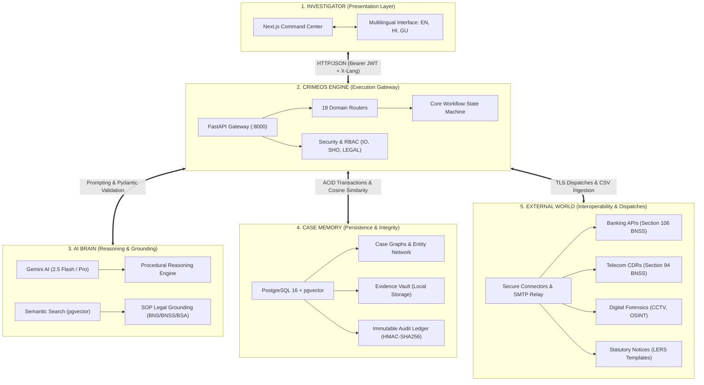
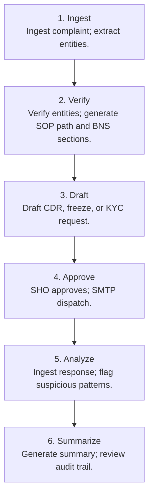
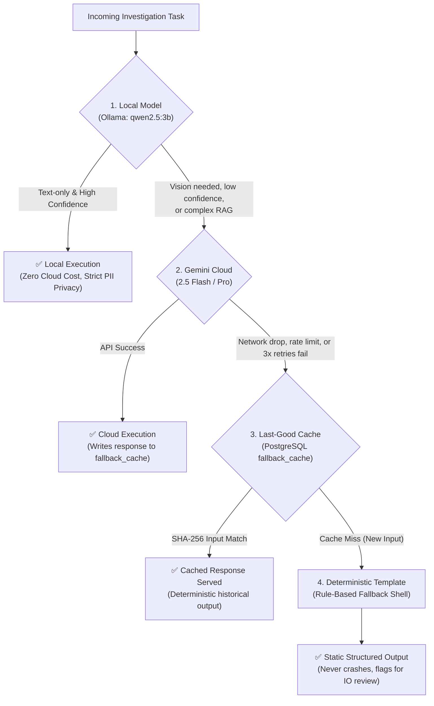

# 🛡️ CrimeOS AI: Complete System Architecture, Workflow & Jury Defense Manual

> **Problem Statement:** ERH26_PS_10 — Intelligence-Led Police Investigation Platform (Cyber & Conventional Crime)  
> **Core Architectural Philosophy:** *Grounding over Magic, Officer-in-the-Loop, and Never-Die Fallbacks.*

---

## 📑 Table of Contents
1. [The 5-Pillar System Landscape & Topology](#1-the-5-pillar-system-landscape--topology)
2. [Forensic Video, Timeline & OSINT Footprint](#2-forensic-video-timeline--osint-footprint)
3. [Chain of Custody & Statutory Grounding (Section 63 BSA)](#3-chain-of-custody--statutory-grounding-section-63-bsa)
4. [Case Intelligence, Analytics & Versioned Summaries](#4-case-intelligence-analytics--versioned-summaries)
5. [The 6-Stage Investigation Lifecycle Spine](#5-the-6-stage-investigation-lifecycle-spine)
6. [5-Layer Hybrid Technology Stack](#6-5-layer-hybrid-technology-stack)
7. [The 4-Tier Fallback Waterfall (Never-Die Architecture)](#7-the-4-tier-fallback-waterfall-never-die-architecture)

---

## 1. The 5-Pillar System Landscape & Topology



### Pillar Breakdown

| Pillar | Sub-components | Responsibility & Implementation |
| :--- | :--- | :--- |
| **1. Investigator** | • Next.js Command Center<br>• Multilingual Interface (EN, HI, GU) | • Dark-mode high-signal operations UI tracking the 6-stage lifecycle.<br>• Native language toggle passing `X-Lang` header while preserving FIR IDs, bank accounts, and legal sections in Latin script. |
| **2. CrimeOS Engine** | • FastAPI Gateway<br>• 18 Domain Routers<br>• Security & RBAC<br>• Core Orchestration | • High-throughput asynchronous gateway utilizing native `BackgroundTasks`.<br>• Modular routers (`/cases`, `/ingestion`, `/paths`, `/requests`, `/video`).<br>• Strict role guards: IO (Investigating Officer), SHO (Approver), LEGAL (Audit).<br>• State machine in `command_center_service.py` enforcing sequential prerequisites. |
| **3. AI Brain** | • Gemini AI<br>• Procedural Reasoning<br>• Semantic Search<br>• SOP Grounding | • Gemini 2.5 Flash / Pro and Files API for video and document understanding.<br>• Semantic similarity search over official police SOP chunks using 768-dim embeddings.<br>• Grounded mapping to Bharatiya Nyaya Sanhita (BNS) and Bharatiya Nagarik Suraksha Sanhita (BNSS). |
| **4. Case Memory** | • PostgreSQL 16 + pgvector<br>• Case Graphs<br>• Evidence Vault<br>• Immutable Audit Ledger | • Unified relational storage and vector database in a single PostgreSQL instance.<br>• Normalized entity networks linking suspects, phones, and bank accounts.<br>• Local evidence storage secured with SHA-256 fingerprints.<br>• Tamper-evident HMAC-SHA256 chained transaction ledger. |
| **5. External World** | • Secure Connectors<br>• Banking APIs<br>• Telecom CDRs<br>• Digital Forensics<br>• Legal Notices | • Authenticated TLS SMTP relays to nodal compliance mailboxes.<br>• Account debit freeze and statement parsing (Section 106 BNSS).<br>• CDR and tower dump parsing (Section 94 BNSS).<br>• Zero-retention cloud video analysis and public OSINT scrapers. |

---

## 2. Forensic Video, Timeline & OSINT Footprint

### Forensic Video & CCTV Pinning (`video_service.py`)
1. **Video Evidence Intake:** Incident and CCTV footage (`.mp4`, `.mov`) is ingested and registered in `evidence_files`.
2. **Zero-Retention Cloud Analysis:** Footage is uploaded to Gemini via the Files API (`gemini_client.upload_file()`). Once the structured incident report is generated, `gemini_client.delete_file()` purges the cloud copy immediately, maintaining station storage custody.
3. **Structured Forensic Reports:** Produces an `IncidentReport` containing executive crime summaries, detected entities (vehicles, plates, clothing, weapons), and risk evaluations (`CRITICAL`, `HIGH`, `MEDIUM`, `LOW`).
4. **Event Log & Click-to-Seek:** Chronological events are saved into `evidence_markers`. In the UI, clicking any timestamp executes `videoRef.current.currentTime = event.timestamp_seconds`, seeking immediately to the relevant frame.
5. **CCTV Frames Pinned to Timeline:** Creates a `TimelineEvent` in the master case timeline (`event_type="cctv_frame"`), placing visual milestones alongside bank transfers and telecom calls.

### OSINT & Digital Custody (`osint_service.py`)
1. **Breach Scans:** Scans suspect emails and phone numbers across breach repositories via `run_deterministic_breach_lookup()`, cataloging compromised credentials into `data_breaches`.
2. **Likely Social Profiles:** Queries 12+ platforms (Instagram, Telegram, GitHub, X, Reddit, etc.), cataloging bios, follower numbers, location hints, and verification marks into `social_profiles`.
3. **Unconfirmed Pivot Extraction:** `extract_pivots_from_bio()` scans bios for secondary phone numbers, emails, and handles. These are flagged as **`unconfirmed`** pivots.
4. **Human-in-the-Loop Promotion:** Unconfirmed leads *never* alter the master case without officer review. Clicking **"Promote to Case Diary"** elevates the lead to a confirmed case entity and triggers recursive scans.
5. **Actor-Attributed Audit Logs:** Every scan enqueue, completion, and pivot promotion logs an event in `audit_service.py` tagged with `user_id`, `case_id`, action type, and exact parameters.

---

## 3. Chain of Custody & Statutory Grounding (Section 63 BSA)

### The Legal Problem
In court, electronic evidence is routinely challenged by defense counsel asserting file substitution, unauthorized edits, or fabricated metadata while in police custody.

### The Statutory Solution: Section 63 BSA
Under **Section 63 of the Bharatiya Sakshya Adhiniyam (BSA, 2023)** (which replaced Section 65B of the Indian Evidence Act), electronic records are admissible only when accompanied by cryptographic proof of authenticity and an unbroken chain of custody.

### Cryptographic Tamper-Evident Ledger (`LedgerService`)
Implemented inside `video_service.py`, evidence lifecycle events form an HMAC-SHA256 hash chain:

```
record_string = f"{case_id}|{event_type}|{canonical_payload}|{prev_hash}"
record_hash   = SHA256(record_string)
signature     = HMAC-SHA256(JWT_SECRET, record_hash)
```


* **Tamper Evidence:** Modifying a single byte in any database row alters its `canonical_payload`, immediately breaking the HMAC signature chain from that point forward.
* **Verification API:** `verify_case_chain(db, case_id)` replays the ledger from genesis to mathematically certify that the record remains pristine.

---

## 4. Case Intelligence, Analytics & Versioned Summaries

### Case Intelligence & Anti-Hallucination
* **Case-Scoped Knowledge Graph:** Normalizes entities (`case_entities`) and limits all queries to the active `case_id`. Cross-contamination between unrelated police FIRs is prevented by database query constraints.
* **Audited AI Mutations:** Any AI-assisted state change (entity extraction, path revision, legal suggestion) is committed via `audit_service.record()`, storing model name, input hashes, and officer approvals.
* **Verified Citations:** Powered by `provenance_service.py` and `AiCitation`. Answers from the Case Copilot return structured citations (`source_type`, `source_id`, `excerpt`, `locator`). Clicking a citation chip in the UI navigates directly to the original complaint paragraph or evidence row.

### Analytics & Response Correlation (`analytics_service.py`)
* **Provider Response Parsing:** Parses incoming CDR and bank statement CSV files into `provider_responses`.
* **Automated Entity Correlation:** Cross-references rows against known case entities:
  * **Bank Transactions:** Flags transfers to or from known suspect accounts with **98% confidence**.
  * **Telecom CDRs:** Identifies incoming/outgoing calls to suspect numbers with **95% confidence**.
* **Promote to Case Diary:** Officer clicks "Promote" on a correlated transaction row, linking it as verified evidence in the formal Case Diary.
* **Adaptive Path Revision:** Triggers `path_revision_service.py` to append new investigative steps dynamically when new suspects or accounts are uncovered.

### Versioned Case Summaries (`summary_service.py`)
* **One-Click Markdown Synthesis:** Synthesizes complaints, extracted entities, procedural steps, legal citations, provider findings, and audit milestones into a formal Markdown prosecution report.
* **Immutable Version History:** Generating an updated summary increments the version (`v1 ➡️ v2 ➡️ v3`). **Past versions are never deleted or modified**, giving judges complete visibility into how police findings developed over time.

---

## 5. The 6-Stage Investigation Lifecycle Spine

Managed by `command_center_service.py`, this state machine advances cases through six mandatory procedural phases:

```
[Ingest] ➡️ [Verify] ➡️ [Draft] ➡️ [Approve] ➡️ [Analyze] ➡️ [Summarize]
```



### Detailed Stage Matrix

| Stage | Action & Human Gate | Technical Implementation | Statutory / Legal Anchor |
| :--- | :--- | :--- | :--- |
| **1. Ingest** | Upload raw complaint (PDF, audio, handwritten photo). | `ingestion_service.py` + `extraction_service.py`: Multilingual OCR, ASR, translation (EN/HI/GU), and 11 entity types. | FIR Registration / Section 173 BNSS |
| **2. Verify** | Human review of entities (Amber alerts if $< 0.80$); SOP path generation. | `path_service.py` + `rag_service.py`: `pgvector` cosine similarity over police SOP chunks; statutory offenses mapped. | **BNS** (Sec 318, 319) & Police SOPs |
| **3. Draft** | Auto-generate formal statutory notices using Jinja2 templates. | `legal_request_service.py`: Pre-fills IFSC, account numbers, and phone numbers. Enforces readiness checks. | **Section 94 & 106 BNSS** |
| **4. Approve** | Station House Officer (SHO) approval gate and dispatch. | Enforces JWT RBAC (`require_role("SHO")`). Sends notice via authenticated TLS SMTP to nodal mailboxes. | Statutory Police Authority |
| **5. Analyze** | Ingest provider response CSVs; correlate money mule transactions. | `analytics_service.py`: Row-level entity matching; one-click promotion to Case Diary; triggers adaptive path revision. | Evidence Collection & CDR Analysis |
| **6. Summarize**| Compile court-ready prosecution dossier; audit verification. | `summary_service.py` + `audit_service.py`: Versioned Markdown summary (`v1, v2...`); Section 63 BSA certificate. | **Section 63 BSA** (Admissibility) |

---

## 6. 5-Layer Hybrid Technology Stack

| Layer | Technology | Primary Responsibility |
| :--- | :--- | :--- |
| **01 — Frontend** | **Next.js 14 (App Router)** | Carbon-surface dark Command Center, tri-lingual toggling (EN/HI/GU), role-guarded actions, interactive Copilot drawer, and click-to-seek video player. |
| **02 — Backend** | **FastAPI (Python 3.11+)** | High-throughput API gateway, JWT HS256 auth, RBAC middleware, Jinja2 legal templating, and asynchronous background tasks without Celery/Redis overhead. |
| **03 — Database** | **PostgreSQL 16 with `pgvector`** | Unified relational schema (25+ tables) combined with 768-dimensional vector datastore for SOP retrieval (`VECTOR(768)`). Manages append-only audit rows. |
| **04 — Local AI** | **Ollama (`qwen2.5:3b`)** | On-premise text extraction, entity normalization, PII data sovereignty, and offline processing during station network outages. |
| **05 — Cloud Escalation** | **Google Gemini AI** | Multimodal CCTV video forensics, cursive handwriting OCR, regional dialect audio transcription, and complex legal synthesis. |

---

## 7. The 4-Tier Fallback Waterfall (Never-Die Architecture)

To ensure police operations never experience software blackouts or unhandled 500 errors, all AI invocations follow a structured 4-tier waterfall:



1. **Tier 1 — Local Model (Ollama `qwen2.5:3b`):** First line of inference. Keeps citizen PII on-premise, delivers zero-latency text parsing, and operates at zero API cost.
2. **Tier 2 — Gemini Cloud (2.5 Flash / Pro):** Escalation handler for multimodal CCTV video streams, regional handwriting OCR, audio ASR, and complex multi-statute synthesis.
3. **Tier 3 — Last-Good Cache (`fallback_cache`):** Cryptographic cache lookup. Uses `SHA-256(prompt + files + model)` to retrieve prior successful responses during internet drops or API throttling.
4. **Tier 4 — Deterministic Template:** Static rule-based safety net. Returns structured boilerplate responses (e.g., `get_deterministic_report()`), ensuring the application never presents blank screens or unhandled exceptions.

---

### 🏛️ Key Takeaways for Presentation & Jury Defense
1. **Officer-in-the-Loop:** AI drafts and recommends; statutory authority (SHO approval, entity verification, pivot promotion) remains strictly with human officers.
2. **Statutory Alignment:** Native support for the July 2024 Indian criminal codes (**BNS**, **BNSS**, and **BSA**), replacing the IPC, CrPC, and Evidence Act.
3. **Cryptographic Integrity:** SHA-256 file fingerprints coupled with an HMAC-SHA256 chained transaction ledger ensure electronic evidence survives judicial scrutiny under Section 63 BSA.
4. **Operational Resilience:** The 4-tier waterfall ensures that stations in remote areas or experiencing internet outages can operate continuously.
