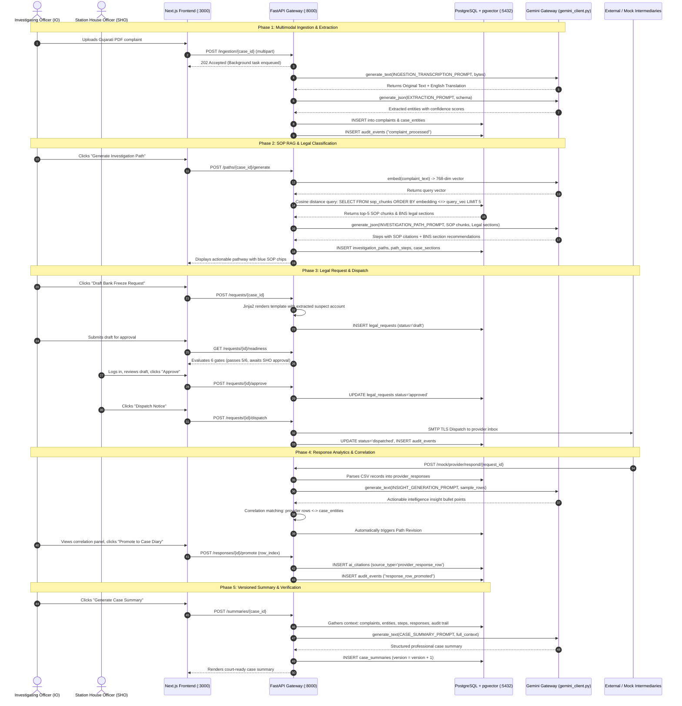

# 🔄 CrimeOS AI — End-to-End Data Flow Specification

This document traces the complete data lifecycle across **CrimeOS AI (eRakshak)**. It details how data enters the platform, is processed by AI services, interacts with PostgreSQL and pgvector, and flows out to the user interface and external systems.

---

## 1. Master Investigation Lifecycle Flow (Golden Path)

```
[Complaint Ingestion]
  │  (PDF / Audio / Handwritten Image / Gujarati / Hindi)
  ▼
[AI Multimodal OCR / ASR & Language Detection]
  │  (Extracts raw text + English translation via Gemini)
  ▼
[Structured Entity Extraction]
  │  (11 entity types: Suspects, Phones, Bank Accounts, UPI IDs, Amounts)
  ▼
[pgvector SOP RAG Retrieval]
  │  (Query SOP chunks using text-embedding-004 cosine similarity)
  ▼
[AI Investigation Path & Statutory Legal Mapping]
  │  (Step-by-step guidance + BNS / BNSS / BSA criminal section suggestions)
  ▼
[Automated LERS Legal Request Drafting]
  │  (Pre-fill Jinja2 templates: CDR, Bank Freeze, Platform Logs)
  ▼
[6 Pre-Dispatch Readiness Gates & SHO Authorization]
  │  (Audits recipient email, legal basis, linkages; SHO approves)
  ▼
[SMTP Notice Dispatch & Response Ingestion]
  │  (Sends TLS email; receives provider CSV/CDR response data)
  ▼
[Response Row Correlation & Case Diary Promotion]
  │  (Matches transactions to suspect entities; promotes records as AiCitations)
  ▼
[Dynamic Investigation Path Revision]
  │  (Re-evaluates investigation path based on new provider evidence)
  ▼
[One-Click Case Summary & Immutable Audit Log]
  │  (Generates versioned summary; records every action in append-only log)
```

---

## 2. Sequence Diagram: Golden Path Investigation Flow



---

## 3. Deep-Dive Data Flows for Critical Subsystems

---

### Flow A: Multimodal Complaint Ingestion & Language Detection

```
[Uploaded File (PDF / Audio / Image)]
         │
         ▼
[ingestion_service.py: process_complaint()]
         │
         ├───► Reads file bytes & determines MIME type
         │
         ├───► Dispatches to gemini_client.transcribe()
         │     ├── Prompt: INGESTION_TRANSCRIPTION_PROMPT
         │     └── Modality: Handles audio transcription & vision OCR
         │
         ├───► Unicode Range Analysis:
         │     ├── Gujarati code points (\u0a80 - \u0aff) > 5  ──► "gu"
         │     ├── Devanagari code points (\u0900 - \u097f) > 5 ──► "hi"
         │     └── Default                                      ──► "en"
         │
         ├───► Splits Gemini response:
         │     ├── Original Text Section    ──► complaint.raw_text
         │     └── English Translation      ──► complaint.translated_text
         │
         ├───► extraction_service.py: extract_entities()
         │     ├── Prompt: EXTRACTION_PROMPT
         │     ├── Gemini JSON mode (schema-enforced)
         │     └── Returns 11 entity types with confidence scores (0.0 - 1.0)
         │
         ├───► entity_service.py: sync_case_entities()
         │     └── Normalizes raw entities into case_entities table
         │
         └───► audit_service.py: record("complaint_processed")
               └── Commits transaction to PostgreSQL
```

---

### Flow B: SOP RAG Retrieval & Legal Section Mapping

```
[Trigger: User requests Investigation Path]
         │
         ▼
[path_service.py / path_revision_service.py]
         │
         ├───► 1. Query Embedding:
         │     gemini_client.embed(complaint_text)
         │     └── Model: text-embedding-004 (768 dimensions)
         │
         ├───► 2. pgvector Cosine Search:
         │     SELECT * FROM sop_chunks
         │     ORDER BY sop_chunks.embedding <=> query_vector
         │     LIMIT 5;
         │     (Fallback: SQL ILIKE text search if embedding unavailable)
         │
         ├───► 3. Keyword Match on Statutory Codes:
         │     Queries legal_sections for relevant BNS, BNSS, BSA statutes
         │
         ├───► 4. LLM Reasoning Call:
         │     gemini_client.generate_json(INVESTIGATION_PATH_PROMPT)
         │     ├── Model: gemini-2.5-pro (deeper reasoning)
         │     ├── Injected Context: Complaint facts + 5 SOP chunks + Legal codes
         │     └── Output Schema: GeminiPathResponse
         │           ├── crime_type: e.g., 'cyber_fraud'
         │           ├── steps: [title, description, sop_citation, suggested_action_type]
         │           └── sections: [code, section_number, ai_reasoning, confidence]
         │
         └───► 5. Persistence & State Update:
               ├── Deactivates previous active path (if revision)
               ├── INSERT INTO investigation_paths & path_steps
               ├── INSERT INTO case_sections
               └── Updates case_workflow_state.current_stage to 'investigate'
```

---

### Flow C: Forensic Video Analysis & Blockchain-Style Ledger

```
[Surveillance Video File Upload (MP4 / MOV)]
         │
         ▼
[video_service.py: analyze_video_task()]
         │
         ├───► 1. Local Persistence:
         │     Saves to /uploads/evidence/{case_id}/
         │     Ledger: append_ledger_event("ANALYSIS_STARTED")
         │
         ├───► 2. Gemini Files API Streaming:
         │     Uploads video via gemini_client.upload_file()
         │     Polls until status == 'ACTIVE' (max_wait=180s)
         │     Ledger: append_ledger_event("GEMINI_UPLOAD_COMPLETE")
         │
         ├───► 3. Forensic Model Analysis:
         │     gemini_client.generate_json_from_file(VIDEO_FORENSIC_ANALYSIS_PROMPT)
         │     Output: IncidentReport
         │       ├── Summary & Crime Classification
         │       ├── Risk Evaluation: LOW / MEDIUM / HIGH
         │       ├── Detected Entities (Vehicles, Weapons, Persons)
         │       └── Timestamped Timeline: [{"00:15": "Suspect exits vehicle"}, ...]
         │
         ├───► 4. Marker & Timeline Insertion:
         │     - Creates EvidenceMarker rows with start_ms / end_ms
         │     - Creates TimelineEvent rows with cctv_analysis metadata
         │     Ledger: append_ledger_event("INCIDENT_REPORT_GENERATED")
         │
         ├───► 5. Cryptographic Evidence Chain (LedgerService):
         │     For each ledger event:
         │       Prev_Hash = Tail hash of previous audit event
         │       Record_Hash = SHA-256(case_id | event_type | canonical_payload | Prev_Hash)
         │       Signature = HMAC-SHA256(Record_Hash, JWT_SECRET)
         │       Stores {ledger_hash, prev_hash, signature} in audit_events.detail
         │
         └───► 6. Verification API: GET /video/{case_id}/chain/verify
               Walks chain from Genesis (64 zeros), recalculates every hash,
               verifies HMAC signatures. Proves video evidence was not altered.
```

---

### Flow D: Tri-Lingual AI Copilot Query & Citation Provenance

```
[Officer asks question in Hindi / Gujarati / English]
  (e.g., "આ કેસમાં કયા પુરાવા મળ્યા છે?" with X-Lang: "gu")
         │
         ▼
[copilot_service.py: ask_copilot()]
         │
         ├───► 1. Records User Message:
         │     INSERT INTO copilot_messages (role='user', message, lang='gu')
         │
         ├───► 2. Intent Resolution:
         │     Maps to canonical intent (next_action, missing_facts, evidence,
         │     legal_basis, provider_response, or generic)
         │
         ├───► 3. Full Case Context Assembly (8 Sections):
         │     [Case Info] + [Complaints] + [Normalized Entities] +
         │     [SOP Steps] + [Legal Sections] + [Provider Responses] +
         │     [Evidence Markers] + [Last 15 Audit Events]
         │
         ├───► 4. Gemini JSON Mode Generation:
         │     Prompt: COPILOT_SYSTEM_PROMPT (target_language: "Gujarati")
         │     Rules Enforced:
         │       - Absolute grounding: "No grounded answer found" if missing
         │       - Generates authoritative English answer (for official audit)
         │       - Generates localized Gujarati answer (for officer UI display)
         │       - Strictly preserves case IDs, section numbers, phone numbers in Latin
         │
         ├───► 5. Citation Extraction & Storage:
         │     For each returned citation:
         │       provenance_service.create_citation()
         │       └── INSERT INTO ai_citations (source_type, source_id, excerpt, confidence)
         │
         ├───► 6. Assistant Message Persistence:
         │     INSERT INTO copilot_messages (
         │       role='assistant',
         │       message=English_answer,
         │       message_localized=Gujarati_answer,
         │       cited_source_ids=[...]
         │     )
         │
         └───► 7. Frontend Rendering:
               Renders Gujarati markdown in Copilot Drawer with interactive,
               clickable source chips linking to raw complaints, records, or SOPs.
```

---

### Flow E: Fallback Cache Execution Flow (Fault Tolerance)

```
[Any AI Service Request (Extraction, Path, Summary, Copilot)]
         │
         ▼
[gemini_client.py: generate_json() / generate_text()]
         │
         ├───► 1. Compute Input Fingerprint:
         │     Input_Hash = SHA-256(json.dumps({prompt, file_meta, model}))
         │
         ├───► 2. Execution Loop (Up to 3 Attempts):
         │     Try:
         │       Call Google Gemini API with timeout
         │       Parse JSON & validate against Pydantic schema
         │       On Success:
         │         Store in fallback_cache table: (purpose, input_hash, response_json)
         │         Return parsed response
         │     Except Exception:
         │       Wait backoff (0.5s * attempt_number)
         │
         └───► 3. On Complete Network / API Failure:
               SELECT response_json FROM fallback_cache
               WHERE purpose = :purpose AND input_hash = :input_hash;
               ├── If Cached Record Exists:
               │     Logs warning, returns cached response (Zero UI disruption)
               └── If No Cache Exists:
                     Serves deterministic rule-based template or raises clean GenerationError
```

---

## 4. Data Transformation & Schema Evolution Matrix

| Stage | Input Data Format | Processing Engine | Output Data Format | Database Table Written |
|---|---|---|---|---|
| **Ingestion** | Binary (PDF, Audio, Scanned JPG) | Gemini Flash (Multimodal) | Verbatim string + English text | `complaints` |
| **Extraction** | English Complaint Text | Gemini Flash (JSON Mode) | Array of typed entity dictionaries | `extracted_entities`, `case_entities` |
| **RAG Retrieval** | Complaint summary string | `text-embedding-004` + pgvector | Top-5 matched text chunks | None (in-memory read) |
| **Path Generation** | Complaint + SOP chunks + Legal codes | Gemini Pro (JSON Mode) | Structured steps + BNS section tags | `investigation_paths`, `path_steps`, `case_sections` |
| **Notice Drafting** | Extracted entity records | Jinja2 Template Engine | Formatted statutory legal letter | `legal_requests` |
| **Response Ingestion**| Raw CSV / Tabular response | Python CSV Parser + Gemini Flash | Parsed JSONB + AI intelligence bullets | `provider_responses` |
| **Video Analysis** | Raw Video File (MP4) | Gemini Files API + Flash | Incident report + MM:SS timeline | `evidence_markers`, `timeline_events` |
| **Chain of Custody**| Operational event payload | HMAC + SHA-256 Ledger Engine | Linked cryptographic hash block | `audit_events` |
| **Summarization** | Aggregated case state (8 DB domains) | Gemini Flash | Formal Markdown case diary | `case_summaries` (versioned) |

---
*Generated as technical documentation for CrimeOS AI (ERH26_PS_10).*
