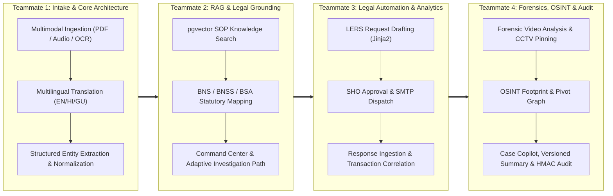

# 🛡️ Crime OS AI: 4-Member Jury Presentation & Defense Blueprint

> **Problem Statement:** ERH26_PS_10 — Intelligence-Led Police Investigation Platform (Cyber & Conventional Crime)  
> **Core Architectural Philosophy:** *Grounding over Magic, Officer-in-the-Loop, and Never-Die Fallbacks.*

---

## 🎯 Executive Overview & Team Division Matrix

To prevent confusion in front of the jury, the project is split into **4 clean, non-overlapping pillars**. Each member owns an end-to-end slice: from the **UI interface** to the **backend business logic**, **database tables**, and **underlying AI algorithms**.



### 📋 Team Ownership Quick Reference

| Teammate | Focus Area | Key UI Views | Key Backend Services | Database Tables |
| :--- | :--- | :--- | :--- | :--- |
| **Teammate 1** | **Multimodal Intake, NLP & Core Architecture** | Ingestion Tab, Side-by-side Translation, Language Toggle, Entity Review | `ingestion_service.py`, `extraction_service.py`, `translate_service.py`, `gemini_client.py` | `complaints`, `extracted_entities`, `case_entities`, `fallback_cache` |
| **Teammate 2** | **SOP Knowledge RAG, Legal Grounding & Workflow Engine** | Investigation Path Tab, SOP Citation Popovers, Legal Section Auditing, Workflow Spine | `rag_service.py`, `path_service.py`, `path_revision_service.py`, `command_center_service.py` | `sop_documents`, `sop_chunks` (`VECTOR(768)`), `legal_sections`, `case_sections`, `investigation_paths`, `path_steps`, `case_workflow_states` |
| **Teammate 3** | **LERS Legal Automation, Dispatch & Response Analytics** | Legal Requests Tab, Readiness Checklist, SHO Approval Gate, Response Correlation Tab | `legal_request_service.py`, `analytics_service.py`, `mock_provider.py`, `mock_cctns.py` | `legal_requests`, `provider_responses`, `entity_relationships` |
| **Teammate 4** | **Forensic Video, OSINT Footprint, Copilot & Immutable Audit** | Video Evidence Workspace, CCTV Pinning, OSINT Panel, Case Copilot Drawer, Summary & Audit | `video_service.py`, `osint_service.py`, `timeline_service.py`, `copilot_service.py`, `summary_service.py`, `audit_service.py` | `evidence_files`, `evidence_markers`, `timeline_events`, `osint_scans`, `social_profiles`, `data_breaches`, `copilot_messages`, `case_summaries`, `audit_events` |

---

## ⏱️ The 6-Minute "Golden Path" Live Demo Relay

Follow this relay during the presentation. Each person speaks for ~90 seconds and executes their specific UI action:

1. **Teammate 1 (0:00 - 1:30):**
   * **Pitch:** *"We built Crime OS AI to eliminate the documentation and procedural bottleneck for police officers."*
   * **Action:** Opens Case 1. Uploads a Gujarati PDF / plays a Hindi audio snippet. Shows the instantaneous OCR, translation, and structured entity extraction. Points out the **Warning Amber** confidence flags.
   * **Hand-off:** *"Now that our verified entities are extracted, Teammate 2 will show how our SOP engine grounds the investigation in Indian law."*

2. **Teammate 2 (1:30 - 3:00):**
   * **Pitch:** *"AI in policing cannot be a hallucinating black box. Everything must have statutory grounding."*
   * **Action:** Shows the AI classifying the crime as Cyber Financial Fraud. Cites **Section 318 BNS** (Cheating) and **Section 66D IT Act**. Clicks an **Investigation Path Step** to open the **Citation Popover**, revealing the exact excerpt from the official police SOP chunk retrieved via `pgvector`.
   * **Hand-off:** *"With this SOP-backed path, the IO needs to freeze the illicit bank account. Teammate 3 will demonstrate our LERS automation."*

3. **Teammate 3 (3:00 - 4:30):**
   * **Pitch:** *"Manual drafting of Section 94 and Section 106 BNSS notices takes hours. We automated it with strict compliance gates."*
   * **Action:** Generates a Bank Freeze Request pre-filled with the extracted IFSC and account numbers. Shows the **Readiness Checklist** passing, switches to the **SHO role** to approve, and fires an SMTP dispatch to the mock nodal mailbox. Ingests the bank's response CSV and shows the **Response Correlation Panel** highlighting money mule transaction flows.
   * **Hand-off:** *"To gather forensic proof and suspect intelligence, Teammate 4 will show our video forensics, OSINT, and tamper-evident audit."*

4. **Teammate 4 (4:30 - 6:00):**
   * **Pitch:** *"Electronic evidence is inadmissible in court without proof of integrity and chain of custody under Section 63 BSA."*
   * **Action:** Opens the Video Evidence Workspace, clicks a timestamped CCTV event that jumps the video player right to the suspect's face. Shows the OSINT digital footprint breach analysis. Generates a one-click case summary and reveals the **HMAC-signed, append-only Audit Trail**.
   * **Conclusion:** *"Crime OS AI turns raw complaints into court-ready prosecution dossiers in minutes."*

---

## 👤 TEAMMATE 1: Multimodal Intake, NLP Pipeline & Core Architecture

### 1. Your Domain & Responsibilities
You own the "front door" of the application: how messy real-world complaints (written in regional Indian languages, spoken over audio, or photographed from paper FIRs) become structured, validated digital case records.

* **Tech Stack Overview:** Next.js 14 App Router (TypeScript, Tailwind, Radix UI) frontend + FastAPI (Python 3.11) backend + PostgreSQL 16 + pgvector.
* **The Gateway Pattern:** Frontend components *never* talk directly to Gemini or PostgreSQL. All AI requests route through `backend/app/ai/gemini_client.py` with typed Pydantic validation and retry logic.
* **Multimodal Extraction:** Gemini 2.5 Flash processes PDFs, images (handwritten OCR), and audio (ASR) in native Gujarati, Hindi, and English.
* **Human-in-the-Loop Review:** The side-by-side UI shows original text vs. translated English. Low-confidence entities (<0.80) are flagged in **Warning Amber** for officer correction before proceeding.

### 2. Key Codebase Files to Study
* `backend/app/ai/gemini_client.py` — Gateway implementation: `generate_json()`, `transcribe()`, fallback caching.
* `backend/app/services/ingestion_service.py` — Orchestrates file saving, language detection, translation, and entity extraction.
* `backend/app/services/extraction_service.py` — Extracts phone numbers, bank accounts, UPI IDs, suspect names, and dates with confidence scores.
* `frontend/app/(authenticated)/cases/[id]/ingestion/page.tsx` — Side-by-side ingestion UI with live edits.

### 3. Likely Jury Questions & How to Answer

> **Jury Q1:** *"Why didn't you use Tesseract for OCR and Whisper for audio transcription instead of an LLM?"*  
> **Your Answer:** "We benchmarked open-source Tesseract and found it fails severely on cursive Indian handwriting and regional Gujarati/Hindi police terminology. Gemini 2.5 Flash is natively multimodal—it reads handwriting and transcribes regional audio accents in a single forward pass, preserving named entities verbatim while translating colloquial idioms into legal English. However, our architecture includes deterministic fallback interfaces so local Whisper/Tesseract engines can be slotted in for air-gapped stations."

> **Jury Q2:** *"What happens if Gemini hallucinates an entity or extracts the wrong bank account number?"*  
> **Your Answer:** "We enforce an 'Officer-in-the-Loop' design. In `extraction_service.py`, every entity has a confidence score. If confidence drops below 0.80, the UI renders a Warning Amber badge. The officer can edit any field directly in our side-by-side review panel before saving. Furthermore, nothing can be dispatched until the officer explicitly verifies it."

> **Jury Q3:** *"What happens if the internet goes down or the Gemini API hits rate limits during live operation?"*  
> **Your Answer:** "In `gemini_client.py`, we implemented an automatic SHA-256 input hashing and fallback cache (`fallback_cache` table). If the external API fails after 3 exponential backoff attempts, the system serves the cached deterministic payload for that document hash. The application never crashes with a 500 error."

---

## ⚖️ TEAMMATE 2: SOP Knowledge RAG, Legal Grounding & Case Workflow Engine

### 1. Your Domain & Responsibilities
You own the "legal intelligence" and "procedural brain" of Crime OS AI. You explain why the system is legally defensible and how an officer is guided through complex procedural workflows.

* **pgvector RAG Grounding:** Official police SOP documents are split into semantic chunks and embedded into 768-dimensional vectors using Gemini `text-embedding-004`. When a complaint is processed, `rag_service.py` runs an SQL cosine similarity query (`SopChunk.embedding.cosine_distance(query_vec)`) directly in PostgreSQL.
* **New Indian Criminal Codes (BNS/BNSS/BSA):** The system maps facts to the new statutory codes that replaced the IPC, CrPC, and Evidence Act in July 2024:
  * **BNS (Bharatiya Nyaya Sanhita):** Substantive offenses (e.g., Section 318 for Cheating, Section 319 for Impersonation).
  * **BNSS (Bharatiya Nagarik Suraksha Sanhita):** Procedural powers (e.g., Section 94 summons, Section 106 property/account seizure).
  * **BSA (Bharatiya Sakshya Adhiniyam):** Electronic evidence admissibility (Section 63).
* **Adaptive Investigation Path & Revisions:** Generates a numbered checklist of procedural steps. When new evidence surfaces, `path_revision_service.py` creates an append-only path revision without destroying previous history.
* **Workflow Spine & Next Best Action:** Computes the overall case state (Ingest ➡️ Classify ➡️ Path ➡️ Request ➡️ Analyze ➡️ Summarize) and recommends the single highest-priority action.

### 2. Key Codebase Files to Study
* `backend/app/services/rag_service.py` — pgvector vector retrieval and fallback keyword search.
* `backend/app/services/path_service.py` — Investigation path generation and legal section recommendations with cited reasoning.
* `backend/app/services/command_center_service.py` — State projection and Next Best Action calculation.
* `frontend/components/citation-dialog.tsx` — Popover component rendering exact SOP paragraphs.

### 3. Likely Jury Questions & How to Answer

> **Jury Q1:** *"Why use pgvector inside PostgreSQL instead of a dedicated vector database like Pinecone, Milvus, or Chroma?"*  
> **Your Answer:** "In a law enforcement system, relational integrity and atomic transactions (ACID) are paramount. With `pgvector`, our relational case data, user permissions, and vector embeddings reside in the *same* database. We can query case metadata, audit events, and SOP vector embeddings in a single atomic transaction without network overhead or data synchronization issues."

> **Jury Q2:** *"India recently replaced the IPC with BNS. How does your model avoid citing outdated IPC sections?"*  
> **Your Answer:** "We do not rely on raw LLM pre-training memory for statutes. We pre-seeded an authoritative database table (`legal_sections`) with exact BNS, BNSS, and BSA statutory texts. During classification, our prompt explicitly injects these statutes as ground truth. In the UI, each suggested section renders a citation card showing the exact statutory text and legal justification."

> **Jury Q3:** *"What is an 'Adaptive Path Revision' and why not just update the path in place?"*  
> **Your Answer:** "Police investigations are subject to judicial scrutiny. If an officer alters an investigative path after discovering a new suspect, the defense attorney in court could challenge the timeline. In `path_revision_service.py`, we treat paths as append-only revisions (`revision_number`, `parent_path_id`, `change_reason`). Previous versions remain preserved in the audit log."

---

## 📨 TEAMMATE 3: Legal Request Automation (LERS), Email Dispatch & Response Analytics

### 1. Your Domain & Responsibilities
You own the operational workflows that connect the police station to external service providers (telecom operators, banks, social platforms).

* **LERS Template Automation:** Under Indian law, police requests must adhere to formal legal notices. Using Jinja2 templates (`templates/requests/`), the system auto-populates extracted entities into standard legal notices:
  * Telecom CDR Notice under **Section 94 BNSS**.
  * Bank Account Debit Freeze Notice under **Section 106 BNSS / Section 102 CrPC**.
  * Social Media IP/Account Logs Notice under **Section 94 BNSS**.
* **Request Readiness Gates:** Before a request can be sent, `check_request_readiness()` validates that: (1) recipient email is present and valid, (2) case entities are verified, and (3) statutory legal basis is explicitly stated.
* **Role-Based SHO Approval Gate:** An Investigating Officer (IO) can only *draft* a legal notice. By statute, formal notices must be authorized by a Station House Officer (SHO). The system enforces this using JWT RBAC in `approve_request()`.
* **SMTP Dispatch & Response Analytics:** Sends the email via SMTP to nodal mailboxes. When provider data returns (e.g., bank statement CSV or CDR call logs), `analytics_service.py` parses the rows, detects suspicious patterns (e.g., immediate mule fund transfers or IMEI hopping), and correlates rows back to case entities with a "Promote to Case Diary" button.
* **Interoperability (CCTNS / eGujcop):** Features a mock API endpoint (`/mock/cctns/sync`) demonstrating how Crime OS AI pushes structured FIR details to state police backends.

### 2. Key Codebase Files to Study
* `backend/app/services/legal_request_service.py` — Template rendering, readiness checks, SHO approval, and SMTP sending.
* `backend/app/services/analytics_service.py` — Response parsing, Gemini-driven insight generation, and correlation engine.
* `backend/app/routers/mock_provider.py` & `mock_cctns.py` — Mock routers simulating telecom, bank, and state police APIs.
* `frontend/app/(authenticated)/cases/[id]/requests/page.tsx` — Request generation and approval workflow UI.

### 3. Likely Jury Questions & How to Answer

> **Jury Q1:** *"Why can't an AI just generate and send the legal notice automatically without human intervention?"*  
> **Your Answer:** "Under Indian criminal procedure, issuing a Section 106 BNSS bank freeze or Section 94 notice is a statutory police power requiring authorized discretion. An autonomous AI sending notices would be legally invalid and vulnerable to abuse. We implement a strict multi-tier gate: AI drafts ➡️ IO reviews ➡️ Readiness audit validates ➡️ SHO approves ➡️ System dispatches."

> **Jury Q2:** *"How do you handle real provider integration when banks and telcos don't offer public APIs?"*  
> **Your Answer:** "In India, the National Cyber Crime Reporting Portal (NCRP) and LERS communicate with nodal officers via authenticated email and designated portal uploads. Our system integrates directly with standard SMTP for email dispatch to registered nodal mailboxes. For testing and demonstration, our internal `/mock/provider` router replicates real telecom CDR CSVs and bank statements."

> **Jury Q3:** *"What is the 'Response Correlation Engine' in your analytics tab?"*  
> **Your Answer:** "When a bank returns a 1,000-row statement, an officer can easily miss connected entities. Our correlation engine in `analytics_service.py` cross-references every transaction row against the case's known entities (accused accounts, phone numbers, UPI IDs). If a match is found, it calculates a 98% confidence link and allows the officer to promote that specific transaction into the official case diary with one click."

---

## 🔍 TEAMMATE 4: Forensic Video/CCTV, OSINT Footprint, Copilot & Immutable Audit

### 1. Your Domain & Responsibilities
You own the deep investigative intelligence, multimedia forensics, intelligence gathering, and tamper-evident auditability required for court trials.

* **Forensic Video Analysis & CCTV Pinning:** Officers upload incident or CCTV footage (MP4/MOV). Using Gemini video understanding in `video_service.py`, the system generates an `IncidentReport` containing timestamped forensic events. The custom video player supports **click-to-seek** directly to flagged timestamps.
* **Chain of Custody & Section 63 BSA:** Electronic evidence requires strict chain of custody to be admissible under Section 63 BSA (formerly Section 65B of the Indian Evidence Act). When an evidence file is uploaded, the system computes an immutable SHA-256 fingerprint.
* **Cryptographic Tamper-Evident Ledger:** Implemented in `LedgerService` (`video_service.py`), each evidence event calculates an HMAC-SHA256 signature chained to the previous record hash (`record_string = f"{case_id}|{event_type}|{canonical_payload}|{prev_hash}"`). Any manual tampering with the database breaks the cryptographic chain.
* **OSINT Digital Footprint Enrichment:** `osint_service.py` scans extracted suspect emails and phone numbers across simulated breach repositories (finding compromised credentials) and scrapes linked social profiles (Instagram, Telegram, GitHub). It extracts "Unconfirmed Pivots" from user bios for one-click case promotion.
* **Grounded Case Copilot:** An interactive drawer powered by `copilot_service.py` allowing officers to query case facts with clickable citation chips.
* **Versioned Summaries & Append-Only Audit:** Generates formal case closing summaries that increment versions (`version = max_version + 1`) in `summary_service.py`. Logs every mutation into an append-only `audit_events` table.

### 2. Key Codebase Files to Study
* `backend/app/services/video_service.py` — Video upload, forensic log generation, and HMAC-SHA256 ledger chaining.
* `backend/app/services/osint_service.py` — OSINT breach queries, social footprinting, and pivot extraction.
* `backend/app/services/timeline_service.py` — Chronological timeline combining AI events, CCTV pins, and manual diary notes.
* `backend/app/services/summary_service.py` & `audit_service.py` — Versioned summaries and append-only audit trail.

### 3. Likely Jury Questions & How to Answer

> **Jury Q1:** *"How do you prove in court that an uploaded CCTV video was not altered or replaced by the police?"*  
> **Your Answer:** "At the instant of upload, `evidence_service.py` computes a cryptographic SHA-256 hash of the binary file and records it in `EvidenceFile`. Furthermore, in `video_service.py`, every lifecycle event is chained into a tamper-evident ledger using HMAC-SHA256 signing with the previous event's hash. If someone modifies a single byte in the file or database row, the signature verification fails, providing complete Section 63 BSA compliance."

> **Jury Q2:** *"Uploading sensitive police CCTV videos to a cloud LLM creates data privacy concerns. How is that addressed?"*  
> **Your Answer:** "In `video_service.py`, we strictly enforce a zero-retention policy. We upload the video using `gemini_client.upload_file()`, extract the structured forensic event report via `generate_json_from_file()`, and immediately execute `gemini_client.delete_file()` to purge the video from Google's servers. The video persists solely on local station storage."

> **Jury Q3:** *"What is the difference between an 'Audit Trail' and a 'Case Summary' in your platform?"*  
> **Your Answer:** "The `audit_events` table is an append-only, immutable technical ledger of every button clicked, AI generation executed, and email dispatched, tagged with user IDs and timestamps. The `case_summaries` table is an officer-facing narrative document synthesized by Gemini from all active case facts. Case summaries are version-controlled—generating an update increments the version number without deleting past summaries, ensuring complete transparency during trial."

---

## 🏛️ General Jury Defense & Cross-Cutting Architecture

Keep these shared architectural principles in mind regardless of who is asked:

### 1. The "Why Did You Build This Architecture?" Elevator Pitch
> *"Most hackathon AI projects build a simple chatbot that outputs unverified text. In law enforcement, unverified text is inadmissible. We built Crime OS AI as a **grounded workflow operating system**: every AI output cites an SOP paragraph or criminal statute, every action requires human verification, and every database transaction writes to an immutable audit trail."*

### 2. Core Architectural Invariants
1. **Frontend Isolation:** The frontend only speaks JSON to FastAPI via `lib/api.ts`. It never touches the database or Gemini directly.
2. **Deterministic Fallbacks:** Every single AI endpoint has a cached or template fallback. If the Gemini API rate limits or drops offline, the demo continues seamlessly.
3. **No Celery/Redis Bloat:** Background jobs (video processing, ingestion) use native FastAPI `BackgroundTasks`, keeping local deployment light, fast, and dependency-free.
4. **Tri-lingual UI:** Full English, Hindi, and Gujarati UI support via 700+ key parity localization dictionaries, with native typography rendering.

---

## 🚀 Recommended Pre-Presentation Action Checklist

Before walking up to the jury:
1. Ensure your PostgreSQL container is running:
   ```bash
   docker-compose up -d
   ```
2. Run database migrations and seeds to pre-populate both demo cases:
   ```bash
   cd backend
   python -m app.seeds.run
   ```
   * *Case 1 (UPI Fraud)* is ready for **Teammate 1 & 2** to demonstrate ingestion and path generation.
   * *Case 2 (Social Media Harassment & Identity Theft)* is pre-populated with provider responses, CCTV video, and OSINT scans for **Teammate 3 & 4** to demonstrate advanced analytics and forensics.
3. Start the FastAPI backend:
   ```bash
   uvicorn app.main:app --reload --port 8000
   ```
4. Start the Next.js frontend:
   ```bash
   cd frontend
   npm run dev
   ```
5. Assign each member their exact 90-second slice, review the Q&A above, and practice the hand-off relay twice!
