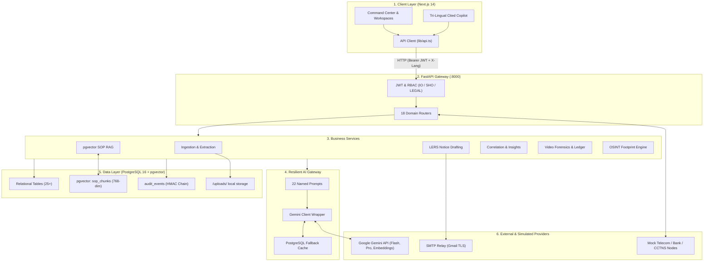

# 🛡️ CrimeOS AI — System Architecture & Technical Specification

CrimeOS AI is an intelligence-led, agentic investigation platform designed for police investigators handling conventional and cyber crimes (**ERH26_PS_10**). It digitizes and automates the complete investigative lifecycle: multimodal regional complaint intake, SOP-grounded investigation pathways, legal notice drafting, response correlation, forensic video analysis, and court-ready case summaries.

---

## 1. High-Level Architecture Diagram (ASCII)

```
+---------------------------------------------------------------------------------------+
|                       1. PRESENTATION LAYER (Next.js 14 App Router)                   |
|  - Dark Command Center UI (Carbon surfaces, high-signal alerts)                       |
|  - Tri-Lingual Support: English, Hindi (हिंदी), Gujarati (ગુજરાતી) via X-Lang header   |
|  - Role-Guarded UI: IO (Investigating Officer) | SHO (Approver) | LEGAL (Advisor)      |
|  - Modular Workspaces: Ingestion, Path, Requests, Responses, Video, OSINT, Timeline   |
|  - Case-Scoped Tri-Lingual Copilot Drawer with interactive citations                  |
+-------------------------------------------+-------------------------------------------+
                                            | HTTP/JSON (Bearer JWT + X-Lang)
                                            v
+---------------------------------------------------------------------------------------+
|                         2. API GATEWAY LAYER (FastAPI :8000)                          |
|  - Auth & RBAC Middleware (OAuth2, JWT HS256, require_role)                           |
|  - Async Background Task Execution (No heavy Celery/Redis bloat)                      |
|  - 18 Domain Routers: /cases, /ingestion, /paths, /requests, /responses, /video, etc. |
+-------------------------------------------+-------------------------------------------+
                                            |
                                            v
+---------------------------------------------------------------------------------------+
|                    3. DOMAIN SERVICES & BUSINESS LOGIC LAYER                          |
|  - Ingestion & Extraction: OCR, ASR, Unicode language detection, 11 entity types       |
|  - SOP RAG Service: Cosine vector similarity retrieval over police SOP chunks          |
|  - Legal Request Engine: Jinja2 drafting (CDR, Bank Freeze) + 6 Pre-Dispatch Gates    |
|  - Response Correlation: Row-level matching to case entities + Case Diary promotion   |
|  - Evidence & Video Forensics: Keyframe seek, incident reports, risk evaluations      |
|  - Tamper-Evident Ledger: SHA-256 hash chaining + HMAC signatures                     |
|  - OSINT Engine: Deterministic profile & breach lookups + bio-pivot candidate parsing  |
|  - Copilot Service: 8-section context assembly + strict anti-hallucination prompts    |
+---------------------+-------------------------------------+---------------------------+
                      |                                     |
                      v                                     v
+-------------------------------------+   +---------------------------------------------+
|    4. RESILIENT AI GATEWAY LAYER    |   |         5. HYBRID DATA STORAGE LAYER        |
|  (backend/app/ai/gemini_client.py)  |   |        (PostgreSQL 16 + pgvector :5432)     |
|                                     |   |                                             |
|  - Central Prompt Registry          |   |  - Relational Schema (25+ Tables):          |
|    (22 Named Prompts)               |   |    cases, complaints, case_entities,        |
|  - Google Gemini Models:            |   |    investigation_paths, legal_requests,     |
|    * gemini-2.5-flash (Extraction)  |   |    provider_responses, copilot_messages     |
|    * gemini-2.5-pro (RAG Paths)     |   |  - Vector Datastore (pgvector):             |
|    * text-embedding-004 (768-dim)   |   |    sop_chunks (768-dim vector embeddings)   |
|    * Gemini Files API (Video stream)|   |  - Chain of Custody & Audit:                |
|  - 3-Attempt Exponential Backoff    |   |    audit_events (Append-only, actor IDs)    |
|  - Fallback Cache (PostgreSQL):     |   |  - AI Fallback Cache:                       |
|    SHA-256 hashed inputs -> cached  |   |    fallback_cache (JSONB responses)         |
|    JSON responses on network drops  |   |  - Local File System:                       |
+---------------------+---------------+   |    /uploads/{case_id}/ (Files, Audio, Video)|
                      |                   +---------------------------------------------+
                      v
+---------------------------------------------------------------------------------------+
|                      6. EXTERNAL PROVIDERS & SIMULATED NODES                          |
|  - Google Gemini API (Multimodal LLM, Vision, Audio, Embeddings)                      |
|  - SMTP Relay (Authenticated TLS dispatch to nodal email inboxes)                     |
|  - Mock Provider Routers (/mock/provider - CDR, Bank, Platform CSV responses)         |
|  - Mock CCTNS / eGujcop Bridge (/mock/cctns/sync - Standardized FIR generation)       |
+---------------------------------------------------------------------------------------+
```

---

## 2. Interactive Flowchart (Mermaid)



---

## 3. Core Architectural Highlights

### 1. Hybrid Relational + Vector Storage (`pgvector`)
* Rather than maintaining a separate vector database (e.g., Pinecone or Chroma), CrimeOS combines standard relational records and vector embeddings inside **PostgreSQL 16** via `pgvector`.
* Standard Operating Procedure (SOP) chunks are stored as `VECTOR(768)`. The investigation path generator runs cosine similarity queries (`cosine_distance`) directly in SQL, keeping deployment lean.

### 2. Resilient AI Gateway & Fallback Caching
* All model calls route through `backend/app/ai/gemini_client.py`.
* Every prompt and media payload is hashed with SHA-256. Successful Gemini responses are cached in the `fallback_cache` table.
* If the external API throttles or disconnects, the system retries 3 times with exponential backoff and automatically serves the cached response. **The application never crashes or presents blank screens to the officer.**

### 3. Court-Admissible Chain of Custody (`LedgerService`)
* For forensic CCTV and video evidence, CrimeOS implements a blockchain-style ledger in `video_service.py`.
* Every stage (file upload, analysis start, marker generation) computes:
  $$\text{Record Hash} = \text{SHA-256}(\text{case\_id} \parallel \text{event\_type} \parallel \text{payload} \parallel \text{prev\_hash})$$
  and signs it with HMAC-SHA256 using `JWT_SECRET`.
* The `verify_case_chain()` API walks the entire chain from genesis to mathematically verify evidence integrity.

### 4. Zero Distributed Overhead
* Engineered **without Celery, Redis, or Kafka**.
* Long-running operations (video analysis, PDF transcription, SMTP dispatch) run as native FastAPI `BackgroundTasks`. This allows local deployment on a single police station workstation or server without complex DevOps infrastructure.

### 5. Native Tri-Lingual Processing (EN, HI, GU)
* The frontend includes complete native dictionaries for English, Hindi, and Gujarati.
* Every HTTP request passes an `X-Lang` header. The backend Copilot returns answers in the officer's selected language while strictly preserving case numbers, phone numbers, and BNS legal sections in standard Latin script.

---

## 4. Technology Stack Summary

| Layer | Technologies |
|---|---|
| **Frontend** | Next.js 14 (App Router), TypeScript, Tailwind CSS, Lucide Icons, Radix UI |
| **Backend** | Python 3.11+, FastAPI, Uvicorn, Pydantic v2 |
| **ORM & DB** | PostgreSQL 16, pgvector, SQLAlchemy 2.0, Alembic |
| **AI Models** | Google Gemini 2.5 Flash, Gemini 2.5 Pro, text-embedding-004 |
| **Templates** | Jinja2 (Official LERS notices: Section 91, Bank Freeze, CDR) |
| **Security** | JWT (HS256), bcrypt password hashing, HMAC-SHA256 evidence chain |
| **Dispatch** | Python `smtplib` with TLS encryption |

---
*Generated as technical documentation for CrimeOS AI (ERH26_PS_10).*
