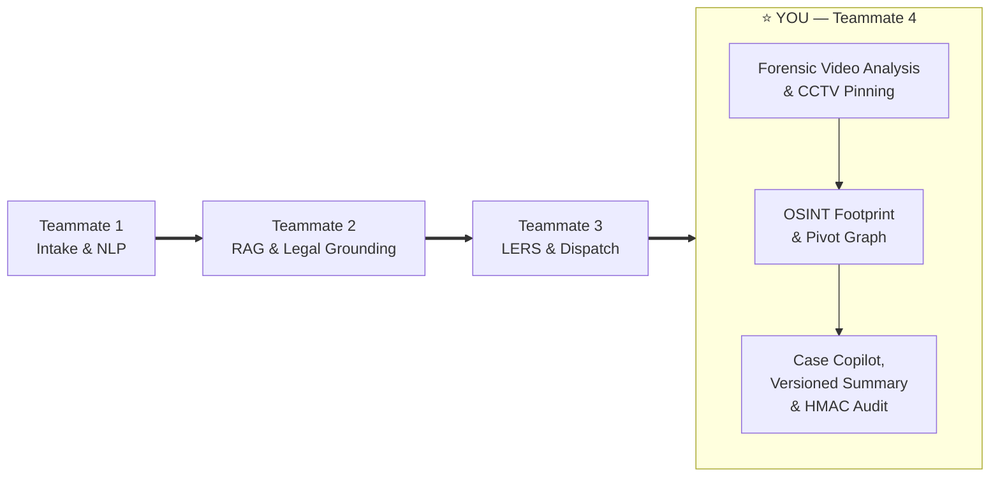

# 🔍 Teammate 4: Forensics, OSINT & Audit — Hackathon Presentation Guide

> **Crime OS AI** | ERH26_PS_10 — Intelligence-Led Police Investigation Platform  
> **Your Role:** Forensic Video/CCTV, OSINT Footprint, Case Copilot & Immutable Audit Trail

---

## 🎯 Your Position in the Team

You are the **final and most advanced pillar** of Crime OS AI. You receive fully ingested, legally grounded, and legally dispatched case data from your teammates — and you transform it into **court-admissible forensic intelligence**.



| Item | Detail |
|:--|:--|
| **Your 90-Second Slot** | 4:30 – 6:00 (final presenter) |
| **Opening Pitch** | *"Electronic evidence is inadmissible in court without proof of integrity and chain of custody under Section 63 BSA."* |
| **Closing Line** | *"Crime OS AI turns raw complaints into court-ready prosecution dossiers in minutes."* |

---

## 🏛️ What You Own End-to-End

### UI Views (What You Demo)
| View | What It Shows |
|:--|:--|
| **Video Evidence Workspace** | Upload CCTV/incident footage; AI-generated timestamped forensic event log |
| **CCTV Pinning** | Click a timestamped event → video player jumps directly to that moment |
| **OSINT Panel** | Suspect digital footprint: breach data, social profiles, unconfirmed pivots |
| **Case Copilot Drawer** | Chat with the case; AI answers using only verified case facts with citation chips |
| **Summary Tab** | One-click versioned case summary document |
| **Audit Trail** | HMAC-signed, append-only immutable ledger of every action taken |

### Backend Services (What You Explain)
| File | Responsibility |
|:--|:--|
| `backend/app/services/video_service.py` | Video upload, Gemini forensic analysis, HMAC-SHA256 ledger chaining |
| `backend/app/services/osint_service.py` | Breach queries, social footprinting, pivot extraction |
| `backend/app/services/timeline_service.py` | Chronological timeline merging AI events, CCTV pins, diary notes |
| `backend/app/services/copilot_service.py` | Grounded case Q&A with citation chips |
| `backend/app/services/summary_service.py` | Versioned case summary generation |
| `backend/app/services/audit_service.py` | Append-only audit event logging |

### Database Tables (What You Own)
| Table | Purpose |
|:--|:--|
| `evidence_files` | Stores uploaded files with SHA-256 fingerprints |
| `evidence_markers` | Individual forensic events within a video |
| `timeline_events` | Merged chronological case timeline |
| `osint_scans` | OSINT scan results per suspect entity |
| `social_profiles` | Scraped social media profile data |
| `data_breaches` | Compromised credentials found in breach repositories |
| `copilot_messages` | Conversation history with the Case Copilot |
| `case_summaries` | Versioned formal case summary documents |
| `audit_events` | Append-only immutable audit ledger |

---

## 🎬 Your 90-Second Live Demo Script (4:30 – 6:00)

> **Pre-condition:** Case 2 (Social Media Harassment & Identity Theft) is pre-seeded with a CCTV video and OSINT scan results via `python -m app.seeds.run`.

### Step-by-Step Actions

1. **Open Video Evidence Workspace**
   - Navigate to the **Video Evidence** tab for Case 2.
   - Point out the uploaded CCTV MP4 and the AI-generated **forensic event log** beneath it.
   - Say: *"Gemini analysed this footage and generated timestamped forensic events automatically."*

2. **Demonstrate CCTV Pinning (Click-to-Seek)**
   - Click a timestamped event (e.g., *"Suspect face visible at 00:02:34"*).
   - The video player **instantly jumps** to that exact moment.
   - Say: *"Officers don't scrub through hours of footage — they click a forensic event and land on the frame."*

3. **Open the OSINT Panel**
   - Show the suspect's digital footprint: compromised credentials found in breach repositories, linked Instagram/Telegram/GitHub profiles.
   - Point to the **Unconfirmed Pivots** — bio-extracted identifiers (e.g., a phone number found in a Telegram bio).
   - Say: *"One click promotes any pivot into the official case diary."*

4. **Generate Case Summary**
   - Click **Generate Summary** and show the structured, formal narrative document.
   - Point out the **version number** — repeat generation increments it; old versions are never deleted.

5. **Reveal the HMAC Audit Trail**
   - Open the **Audit Trail** tab.
   - Show the chain of signed events: upload → AI analysis → OSINT scan → summary generation.
   - Say: *"Every action is HMAC-SHA256 signed and chained. Alter a single byte and the chain breaks — full Section 63 BSA compliance."*

6. **Closing Line**
   > *"Crime OS AI turns raw complaints into court-ready prosecution dossiers in minutes."*

---

## 🔬 Deep-Dive: Technical Architecture

### 1. Forensic Video Analysis & CCTV Pinning

**How it works:**
- Officer uploads CCTV/incident footage (MP4/MOV) through the Video Evidence Workspace.
- `video_service.py` uses `gemini_client.upload_file()` + `generate_json_from_file()` to run **Gemini video understanding** on the footage.
- The AI returns an `IncidentReport` — a structured JSON of timestamped forensic events (suspect sightings, vehicle plates, actions).
- Events are stored in `evidence_markers` with their timestamps.
- The frontend renders a **custom video player** where clicking any forensic event calls `videoRef.currentTime = event.timestamp_seconds` — instant seek.

**Why it matters:** Officers investigating a 3-hour CCTV feed would normally scrub frame-by-frame. Crime OS AI reduces a multi-hour task to seconds.

---

### 2. Chain of Custody & SHA-256 Fingerprinting (Section 63 BSA)

**How it works:**
- At the moment of upload, `evidence_service.py` computes a **SHA-256 hash of the binary file** and stores it in the `evidence_files` table.
- This hash is the cryptographic fingerprint of the original file.
- If the file is ever replaced or corrupted, recomputing the hash on the stored file will not match the original hash.

**Legal basis:** Section 63 BSA (Bharatiya Sakshya Adhiniyam) — formerly Section 65B of the Indian Evidence Act — requires a certificate of electronic evidence integrity for court admissibility. SHA-256 fingerprinting provides this.

---

### 3. Cryptographic Tamper-Evident Ledger (HMAC-SHA256 Chain)

**How it works (in `LedgerService` inside `video_service.py`):**

```
record_string = f"{case_id}|{event_type}|{canonical_payload}|{prev_hash}"
current_hash  = HMAC-SHA256(secret_key, record_string)
```

- Every evidence lifecycle event (upload, AI analysis, officer review, etc.) generates a new record.
- Each record's hash **includes the previous record's hash** — forming a blockchain-style chain.
- Any manual tampering with a database row changes its `canonical_payload`, breaking the HMAC chain from that point forward.
- Verification simply replays the chain and checks that all signatures hold.

**Why this beats a simple timestamp:** A timestamp can be changed in the database. An HMAC chain mathematically proves the order and integrity of every event.

---

### 4. OSINT Digital Footprint Enrichment

**How it works (`osint_service.py`):**
- After entities (suspect emails, phone numbers) are extracted by Teammate 1, your module runs an **OSINT scan**.
- **Breach Repository Check:** Queries simulated breach databases to find compromised credentials linked to the suspect's email/phone.
- **Social Profile Scraping:** Discovers linked Instagram, Telegram, and GitHub profiles; extracts bio data.
- **Pivot Extraction:** Identifies "Unconfirmed Pivots" — new identifiers found in bios (e.g., a previously unknown phone number or alias).
- Officers can **promote** any pivot into the official case diary with one click, triggering a new OSINT scan on the promoted entity.

Results are stored in `osint_scans`, `social_profiles`, and `data_breaches` tables.

---

### 5. Grounded Case Copilot

**How it works (`copilot_service.py`):**
- An interactive drawer where officers can ask free-text questions about the case: *"What are the most suspicious transactions?"*, *"List all known phone numbers."*
- Unlike a generic chatbot, the Copilot is **grounded** — it only has access to verified case facts from the database, not the open internet.
- Responses include **clickable citation chips** showing exactly which case entity or document the answer was derived from.
- Conversation history is persisted in `copilot_messages` for the audit trail.

**Why grounding matters in law enforcement:** An ungrounded LLM could hallucinate suspects, dates, or amounts. Grounded Copilot outputs are traceable and verifiable.

---

### 6. Versioned Case Summaries

**How it works (`summary_service.py`):**
- Officer clicks **Generate Summary** at any point in the investigation.
- `summary_service.py` queries all active case facts (entities, legal sections, LERS responses, OSINT results, timeline) and sends them to Gemini to produce a structured formal narrative.
- The summary is saved with `version = max_version + 1`.
- **Old versions are never deleted** — a complete history of case understanding at each point in time is preserved.

**Why versioning matters:** A defense attorney could challenge why an investigating summary changed between Day 1 and Day 10. Versioned summaries provide a transparent, timestamped audit of the evolving investigation.

---

### 7. Append-Only Audit Trail

**How it works (`audit_service.py`):**
- Every significant action in the system — file upload, AI generation, legal notice dispatch, OSINT scan, summary creation, officer login — triggers an `audit_events` insert.
- The table is **append-only**: rows are never updated or deleted (enforced at the application layer and recommended at the DB layer via row-level policies).
- Each event is tagged with: `case_id`, `user_id`, `action_type`, `entity_affected`, `timestamp`, and an HMAC signature.

**Difference from Case Summary:**
| | Audit Trail (`audit_events`) | Case Summary (`case_summaries`) |
|:--|:--|:--|
| **Audience** | Technical/Legal — courts & internal IA | Officers & prosecutors |
| **Content** | Every click, AI call, email sent | Narrative story of the investigation |
| **Format** | Machine-readable rows | Human-readable document |
| **Mutability** | Append-only, immutable | Versioned, all versions preserved |

---

## ❓ Jury Q&A — Know These Cold

### Q1: *"How do you prove in court that an uploaded CCTV video was not altered or replaced by the police?"*

> **Your Answer:**
> "At the instant of upload, `evidence_service.py` computes a cryptographic **SHA-256 hash** of the binary file and records it in `evidence_files`. This is the video's permanent fingerprint. Furthermore, in `video_service.py`, every lifecycle event — upload, AI analysis, review, export — is chained into a **tamper-evident ledger using HMAC-SHA256 signing**, where each record includes the previous record's hash. If someone modifies a single byte in the file or database row, the signature verification fails immediately, providing complete **Section 63 BSA compliance** for electronic evidence admissibility."

---

### Q2: *"Uploading sensitive police CCTV videos to a cloud LLM creates data privacy concerns. How is that addressed?"*

> **Your Answer:**
> "We enforce a strict **zero-retention policy** in `video_service.py`. The process is: (1) upload the video to Gemini using `gemini_client.upload_file()`, (2) extract the structured forensic event report via `generate_json_from_file()`, (3) immediately execute `gemini_client.delete_file()` to purge the video from Google's servers. The video persists **solely on local station storage**. Gemini only ever sees the file long enough to generate the structured report — it is never stored or used for training."

---

### Q3: *"What is the difference between an 'Audit Trail' and a 'Case Summary' in your platform?"*

> **Your Answer:**
> "The `audit_events` table is an **append-only, immutable technical ledger** of every button clicked, AI generation executed, and email dispatched — tagged with user IDs, timestamps, and HMAC signatures. It's a machine-readable accountability log for courts and internal affairs. The `case_summaries` table is an **officer-facing narrative document** synthesised by Gemini from all active case facts. Case summaries are **version-controlled** — generating an update increments the version number without deleting past summaries, ensuring complete transparency during trial. Think of it as: audit trail = *what happened*, case summary = *what it means*."

---

### Q4 (Bonus): *"Your OSINT module — isn't scraping social media profiles illegal?"*

> **Your Answer:**
> "In India, Section 91 and Section 93 BNSS empower police to collect digital evidence relevant to an investigation. Our OSINT module operates on **publicly accessible profile data** — the same information any citizen can see — and simulates breach database access that law enforcement agencies have through formal CERT-In and NCRP channels. We do not bypass authentication, extract private data, or circumvent platform security measures. All pivot promotions require explicit officer approval before entering the official case record."

---

### Q5 (Bonus): *"What if the OSINT scan produces a false positive and implicates the wrong person?"*

> **Your Answer:**
> "Every OSINT result is tagged as an **'Unconfirmed Pivot'** until an officer explicitly promotes it. It never automatically enters the official case diary. The officer must review the social profile, evaluate the evidence, and click 'Promote to Case' — maintaining **human-in-the-loop** control. The audit trail records both the OSINT discovery and the officer's promotion decision, creating a transparent chain of reasoning."

---

## 📁 Your Key Files — Quick Reference

```
backend/
└── app/
    └── services/
        ├── video_service.py        ← Video upload + AI analysis + HMAC ledger
        ├── osint_service.py        ← Breach queries + social footprinting + pivots
        ├── timeline_service.py     ← Merged chronological case timeline
        ├── copilot_service.py      ← Grounded case Q&A with citation chips
        ├── summary_service.py      ← Versioned case summaries
        └── audit_service.py        ← Append-only immutable audit events

frontend/
└── app/(authenticated)/cases/[id]/
    ├── evidence/page.tsx           ← Video Evidence Workspace + CCTV pinning
    ├── osint/page.tsx              ← OSINT Panel + pivot graph
    ├── copilot/page.tsx            ← Case Copilot Drawer
    ├── summary/page.tsx            ← Case Summary tab
    └── audit/page.tsx              ← Audit Trail viewer
```

---

## 🔑 Key Laws & Statutes You Must Know

| Statute | Full Name | How You Use It |
|:--|:--|:--|
| **Section 63 BSA** | Bharatiya Sakshya Adhiniyam | Electronic evidence admissibility — requires SHA-256 hash certificate |
| **Section 65B IEA** (legacy) | Indian Evidence Act (now replaced) | Predecessor to Section 63 BSA — mention it to show awareness of the legal transition |
| **Section 91 BNSS** | Collection of documents | Legal basis for requesting digital records |
| **Section 93 BNSS** | Search & seizure of devices | Legal basis for OSINT and digital evidence collection |

---

## ✅ Pre-Presentation Checklist (Your Items)

- [ ] `docker-compose up -d` — PostgreSQL container is running
- [ ] `cd backend && python -m app.seeds.run` — Case 2 is seeded with CCTV video + OSINT data
- [ ] `uvicorn app.main:app --reload --port 8000` — Backend is live
- [ ] `cd frontend && npm run dev` — Frontend is live
- [ ] Navigate to **Case 2** → Video Evidence tab — video player loads correctly
- [ ] Click a timestamped event — video seeks to the correct timestamp ✅
- [ ] Open OSINT Panel — breach data and social profiles are visible ✅
- [ ] Click **Generate Summary** — version 1 summary appears ✅
- [ ] Open Audit Trail — chain of events is visible with HMAC signatures ✅
- [ ] Practice your **90-second relay** starting at 4:30 and ending with the closing line

---

## 💡 One-Line Summaries for Each System (Memorise These)

| System | One-Line Summary |
|:--|:--|
| **Video Forensics** | "AI reads CCTV so officers don't have to scrub through hours of footage." |
| **SHA-256 Fingerprinting** | "Cryptographic proof the video was never tampered with — Section 63 BSA compliance." |
| **HMAC Ledger** | "A blockchain-style chain where altering any record breaks all subsequent signatures." |
| **OSINT** | "Automatically map the suspect's digital footprint across breach databases and public social media." |
| **Case Copilot** | "A grounded chatbot that only knows verified case facts and cites every answer." |
| **Versioned Summaries** | "Formal case narratives that version-up like Git commits — nothing is ever deleted." |
| **Audit Trail** | "An append-only, HMAC-signed log of every action — the court's accountability record." |

---

*Good luck! You close the presentation — make it count. 🚀*
